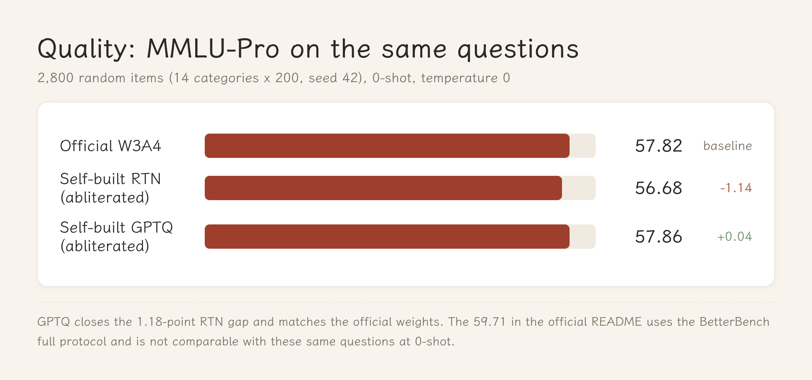
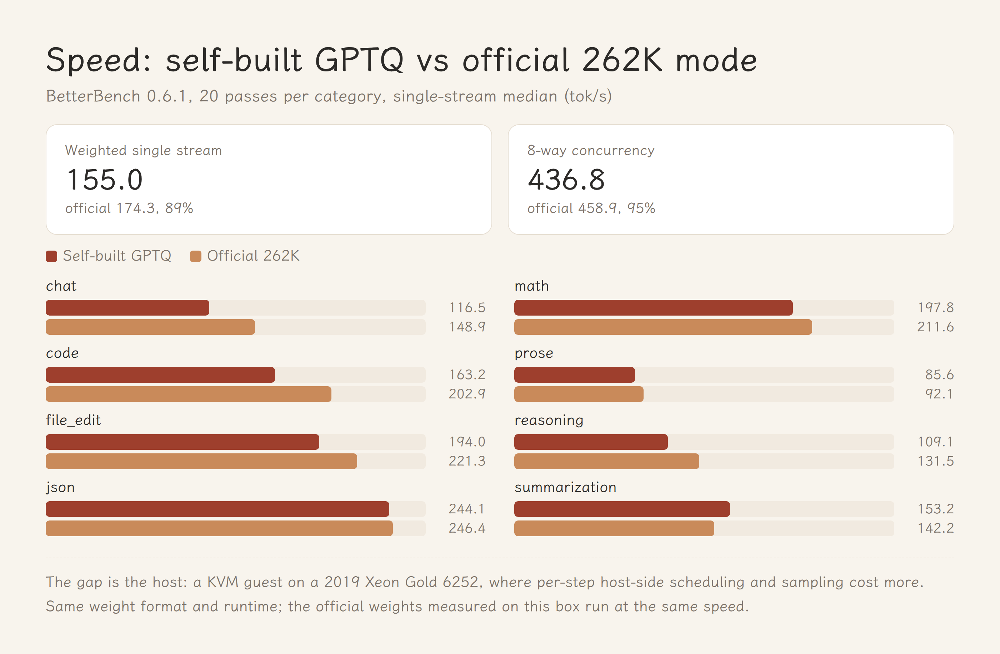

# Abliterated Qwen3.8-27B on Paiton's 3-bit W3A4 stack

**TL;DR** — The official Paiton 3-bit weights don't cover abliterated checkpoints. I reverse-engineered the
`paiton-w3rot-v1` format, wrote a packer, got an RTN build running, then added GPTQ/Hessian calibration. On the
**same 2,800 MMLU-Pro questions** the final build scores **57.86%** against **57.82%** for the official weights.
Single-stream speed is 89% of the official 262K profile; 8-way concurrency is 95%.



## Why you cannot just edit the 3-bit weights

Abliteration is a rank-1 edit: it subtracts a refusal direction from `o_proj` / `down_proj`. Measured on the real
weights, a standard λ=1 edit moves each element by ~2% of a 3-bit quantization step — **not a single code changes**
after re-rounding. The order has to be: **uncensor in bf16, then quantize**.

## The format

`paiton-w3rot-v1` is undocumented. Reverse-engineered from the shard headers:

- rotated sites are right-multiplied by a block-diagonal Hadamard-128 (`W·H128`); activations must be rotated too;
- 3-bit symmetric, group 128, `q ∈ [-4, 3]` stored as `u = q + 4`, **signed bf16 scale**;
- dense LSB-first bit stream packed into int32 words;
- `in_proj_a/b` are stored as bf16 `weight_rot_h128`; the manifest's `side.source_sha256_by_layer` hashes the
  **source bf16 bytes**, not the shard.

The packer round-trips byte-identically (unpack → requantize → repack, 6/6 tensors on L00).

## GPTQ on a 32 GB card

The 27B bf16 checkpoint is 54 GB, so calibration runs on a 4-bit NF4 copy of the abliterated model:

- bitsandbytes NF4, eager attention (sdpa fails with `invalid argument` on this ROCm build);
- 8×2048 × 4 batches = 65,536 calibration tokens (WikiText-103 + Chinese Wikipedia);
- Hessian stored **block-diagonal per 128-column group** (136 × 128×128), with column-wise GPTQ error
  compensation inside each group; the 14-candidate group-scale search is kept.

## Results



| Benchmark | This build | Official W3A4 |
|---|---:|---:|
| MMLU-Pro, 14×200 random, 0-shot | **57.86%** | 57.82% |
| GSM8K 5-shot (1,319) | 93.10% | 95.30% |
| HumanEval pass@1 (164) | 90.24% | 93.90% |
| Needle @ 61,440 tokens (160) | 160/160 | 100 |

## Reproduce

```bash
python3 scripts/build_gptq2.py --src /path/to/abliterated-bf16 --out ./out \
        --calib calib.txt --batches 4 --nseq 8
python3 scripts/gen_manifest.py ./out /path/to/official/w3rot-manifest.json /path/to/abliterated-bf16
```

Build takes about 10 minutes once the model is on disk. Weights are published on Hugging Face (link in the release).

## Limits

Block-diagonal rather than full Hessian; no scale distillation; abliteration removes the refusal direction, not
policy; validated on one GPU only.

## Licence

Forked from the Apache-2.0 `paiton-vllm-plugin`. Weights derive from the Apache-2.0
[huihui-ai abliterated checkpoint](https://huggingface.co/huihui-ai/Huihui-Qwen3.8-27B-abliterated) and the
Apache-2.0 [unsloth NVFP4 base](https://huggingface.co/unsloth/Qwen3.8-27B-NVFP4). Research and personal use only;
outputs are the user's responsibility.
