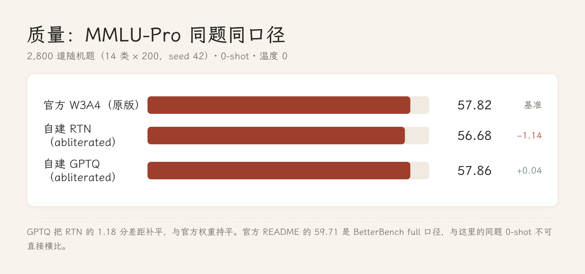
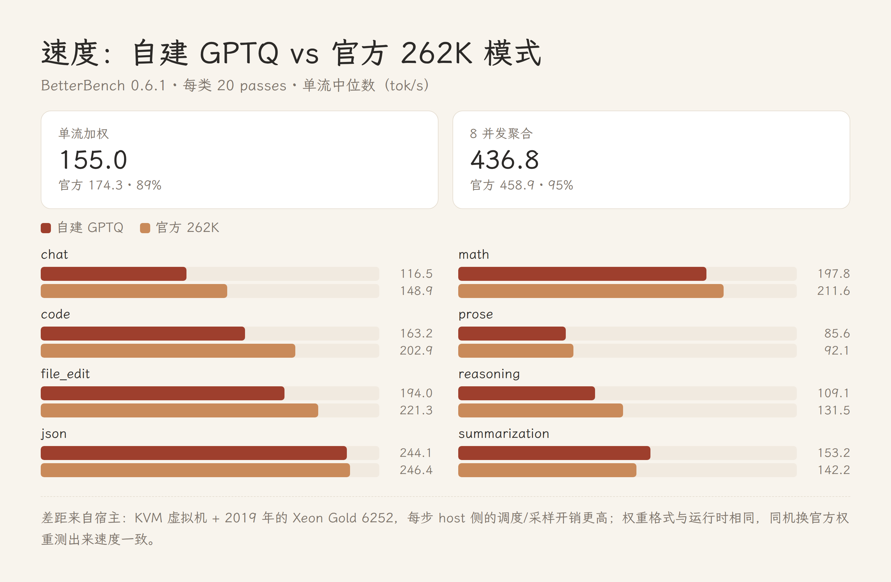

# 把 abliterated 的 Qwen3.8-27B 压进 Paiton 的 3-bit W3A4

**一句话**——官方 Paiton 3-bit 权重不覆盖 abliterated 检查点。我逆向了 `paiton-w3rot-v1` 格式、写了打包器、先跑通 RTN，再补上 GPTQ/Hessian 校准。在**同一批 2,800 道 MMLU-Pro 题**上，最终版本 **57.86%**，官方权重 **57.82%**；单流速度是官方 262K 档的 89%，8 并发 95%。



## 为什么不能直接改 3-bit 权重

abliteration 是 rank-1 编辑：从 `o_proj` / `down_proj` 里减掉拒绝方向。在真实权重上实测，标准 λ=1 的编辑让每个元素只移动约 2% 的量化步长——重新四舍五入后**一个码都不变**。所以顺序只能是：**先 bf16 去审查，再量化**。

## 格式

`paiton-w3rot-v1` 没有公开文档，从分片头反推出来：

- 旋转站点右乘 block-diagonal Hadamard-128（`W·H128`），激活侧必须同步旋转；
- 3-bit 对称、group=128、`q ∈ [-4,3]` 存成 `u=q+4`，**scale 是有符号 bf16**；
- dense LSB-first 位流打进 int32 字；
- `in_proj_a/b` 以 bf16 `weight_rot_h128` 存放；manifest 的 `side.source_sha256_by_layer` 校验的是**源 bf16 字节**，不是分片。

打包器做到字节级往返（解包 → 重量化 → 重打包，L00 上 6/6 张量一致）。

## 32G 显存下的 GPTQ

27B bf16 是 54 GB，单卡装不下，所以校准跑在 4-bit NF4 副本上：

- bitsandbytes NF4 + eager attention（这套 ROCm 上 sdpa 会报 `invalid argument`）；
- 8×2048 × 4 批 = 65,536 个校准 token（WikiText-103 + 中文维基）；
- Hessian 按 128 列分组存**块对角**（136 个 128×128），组内做列级 GPTQ 误差补偿；组 scale 仍用 14 候选搜索。

## 结果



| 基准 | 本版本 | 官方 W3A4 |
|---|---:|---:|
| MMLU-Pro，14×200 随机，0-shot | **57.86%** | 57.82% |
| GSM8K 5-shot（1,319） | 93.10% | 95.30% |
| HumanEval pass@1（164） | 90.24% | 93.90% |
| Needle @ 61,440 token（160） | 160/160 | 100 |

## 复现

```bash
python3 scripts/build_gptq2.py --src /path/to/abliterated-bf16 --out ./out \
        --calib calib.txt --batches 4 --nseq 8
python3 scripts/gen_manifest.py ./out /path/to/official/w3rot-manifest.json /path/to/abliterated-bf16
```

模型在盘上的情况下，构建约 10 分钟。权重发布在 Hugging Face（见 release）。

## 局限

块对角 Hessian 不是全 Hessian；没做 scale 蒸馏；abliteration 拆的是拒绝回路，不是政治立场；只在一张卡上验证。

## 许可

fork 自 Apache-2.0 的 `paiton-vllm-plugin`；权重派生自 Apache-2.0 的
[huihui-ai abliterated 检查点](https://huggingface.co/huihui-ai/Huihui-Qwen3.8-27B-abliterated) 与
Apache-2.0 的 [unsloth NVFP4 基座](https://huggingface.co/unsloth/Qwen3.8-27B-NVFP4)。仅供研究与自用，输出由使用者负责。
